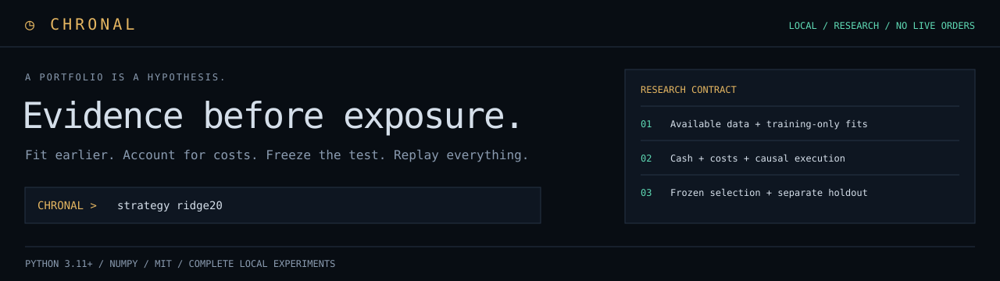
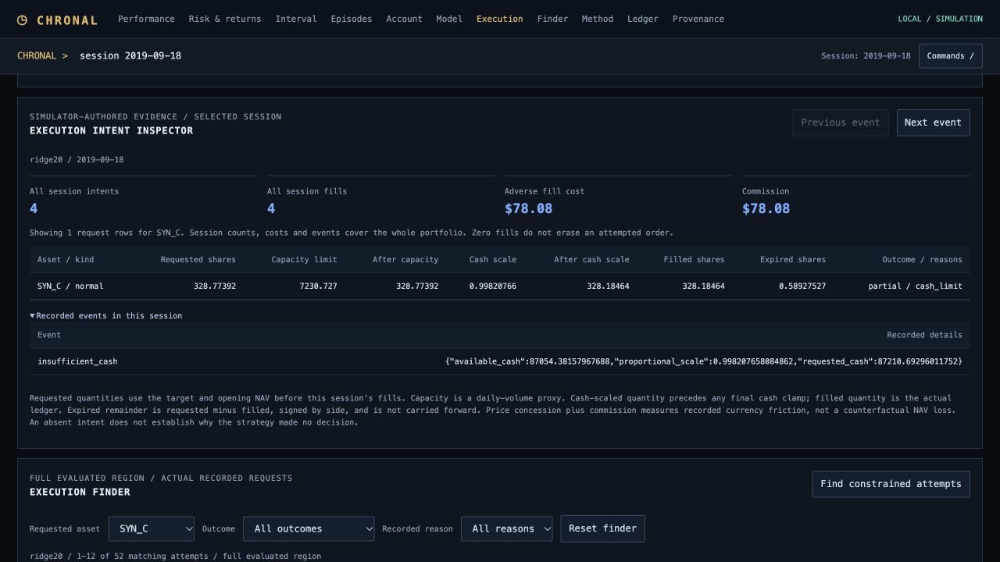

**A local investment research lab that turns a strategy hypothesis into a portfolio you can inspect and replay.**

Python 3.11+ · One runtime dependency · MIT · No accounts or API keys

[Source](https://github.com/nazeeh111/chronal) · [Checks](https://github.com/nazeeh111/chronal/actions/workflows/checks.yml) · [Verification record](docs/VALIDATION.md)

Chronal connects constrained strategy proposals, train-only machine learning, cash-aware simulation, chronological evaluation and standalone reports. Its useful unit is a complete experiment: the data, candidate registry, fitted models, selection decision, fills, costs and evidence all travel together.

**Research software, version 0.1.0.** No live brokerage route. The bundled demonstration uses fictional prices. It does not establish an investable edge, historical LLM skill or superiority over mature trading engines.



The [terminal source research](docs/research/TERMINAL.md) connects the interface to real research tasks: inspect a registered portfolio, navigate evidence, find an exact session and reconcile its account. The terminal is a saved, offline experiment with actual simulation data. It contains no live ticker feed or order route.

## Use the research terminal

Open a generated report and press `/` to focus the command bar. Use `help` or Commands for a searchable palette and full reference. Choosing a command prepares it; press Enter to run. Alt+Up/Down recalls recent submitted commands and restores your draft.

| Command | Behavior |
|---|---|
| `strategy ridge20` | Coordinate the chart, diagnostics and account around that registered strategy |
| `view drawdown` | Inspect the initial-capital-inclusive drawdown path |
| `session 2019-01-02` | Inspect a unique UTC date; `session #20` addresses a session position |
| `range 2019-01-01 2019-01-31` | Compare inclusive interval returns, local drawdown and fees against the same baseline dates |
| `asset #3` | Focus the third recorded asset across holdings, requests, finder and fills; `asset` clears focus |
| `find constrained` | Find partial or blocked attempts across the region, then inspect their exact session |
| `find all` | Reset execution-finder filters |
| `fit #2` | Inspect the second recorded fit and its training-only scaler and coefficients |
| `next-event` / `previous-event` | Jump to the next or previous recorded execution/risk event |
| `goto execution` | Inspect requested, constrained, filled and expired shares for the selected session |
| `goto account` | Inspect marked cash/invested weights, inventory and session fill activity |
| `goto risk` | Inspect downside diagnostics and monthly net-return matrix |

The frozen development selection stays visible while you inspect other candidates. Monthly cells distinguish missing months from actual zero returns. Click or tap the plot to inspect a session. Click a monthly return to compare its actual interval, or inspect a drawdown trough to jump to the matching account. These are descriptive inspections: the full-region metrics and frozen selection stay intact. Ledger filters combine asset, buy/sell side and the selected session, retaining signed share quantities and paginated results. Asset focus synchronizes the detailed tables while preserving portfolio totals. The execution finder searches actual requests by asset, outcome and reason, with direct session jumps. The model inspector shows the rule or recorded ridge fit behind that session; the execution inspector shows actual requested, constrained, filled and expired shares. [Terminal guide](docs/TERMINAL.md) · [Interaction research](docs/research/INTERACTIVE.md) · [Execution research](docs/research/NEXT.md) · [Terminal workflow research](docs/research/FINAL.md) · [Typed inspection research](docs/research/PUBLICATION.md).

## Try the complete workflow

From this repository directory:

```sh
python3 -m venv .venv
source .venv/bin/activate
python -m pip install -e .
python -m chronal demo --out demo-run
python -m chronal verify demo-run --replay
```

Open `demo-run/development/report.html`, then `demo-run/holdout/report.html` in your browser. Both are self-contained; all scripts, styles and data are inline. The installed `chronal` command is equivalent to `python -m chronal`. Use a fresh destination for each run; existing results are never silently overwritten.

Already have NumPy? The source runs directly without installing Chronal. The [checked-in demonstration](examples/demo/development/report.html) and [holdout report](examples/demo/holdout/report.html) are available immediately, with their raw data and recipes. GitHub displays HTML source; download the repository and open the file to interact with it.

## What you get

| Part | Implemented behavior |
|---|---|
| Data contract | Validated synchronized OHLCV CSV, explicit UTC instants and publication availability, immutable arrays, semantic hashes |
| Strategies | Equal weight, ranked positive momentum, all-positive trend, pooled ridge regression with training-only preprocessing |
| Portfolio controls | Long-only targets, position caps, covariance-based exposure reduction, retained cash, publication-aware drawdown circuit |
| Execution | Later-open fills, overnight gaps, adverse spread/slippage, commissions, fee-aware shared cash, sell-before-buy, bounded daily capacity, persisted per-asset intent and expiry |
| Evaluation | Expanding chronological fits, purged label boundaries, cash continuity across folds, development-only candidate selection, separate holdout |
| Robustness | Double-cost and delayed-execution stresses, explicit undefined ratios, paired descriptive block bootstrap, complete trial registry for each plan |
| AI interface | Development-only review packet and strictly bounded JSON proposals; no arbitrary code execution or paid model API |
| Evidence | Fitted coefficients and label endpoints, fill/position/cash ledger, CSV exports, source/data/artifact hashes, independent accounting checks and full replay |
| Presentation | Standalone interactive equity/drawdown report, strategy comparison, linked model/intent/session inspectors, event navigation, fold table, paginated ledger and provenance |

No strategy, including ridge, is assumed to beat the baseline. In the checked-in demo, the development winner **loses money on the holdout**. A separate [12-replication synthetic study](docs/EXPERIMENT.md) retains every result: only 3 of 12 selected candidates beat the baseline on their holdouts. Negative results are part of the product.

## Follow the research contract


The [architecture guide](docs/ARCHITECTURE.md) and [timing figure](docs/figures/causal-timing.svg) trace the actual implementation. Figures are editable vectors produced through the PaperBanana-derived Flowcraft workflow, with rendered previews and source-to-element provenance.

## Bring your own data

Use the exact [CSV schema and provenance contract](docs/DATA.md), and replace the fields in `examples/metadata.template.json` with actual facts. The generated `examples/demo/input.csv` shows the required shape; its prices are synthetic.

```sh
python -m chronal validate --data prices.csv --metadata metadata.json
python -m chronal plan --data prices.csv --metadata metadata.json --out runs/first
python -m chronal research runs/first
# Inspect development/report.html and the frozen selection before opening the holdout.
python -m chronal holdout runs/first
python -m chronal verify runs/first --replay
```

The plan freezes data, source, candidates, cost assumptions and windows before evaluation. `research` truncates its numerical input before the holdout. `holdout` verifies and recomputes development selection, then evaluates only the frozen candidate and baseline. Each result folder is written atomically.

The input file remains accessible to you. Local hashes are not a tamper-proof seal or an independent timestamp, and Chronal cannot discover your previous trials elsewhere. After opening a holdout, treat it as observed. Use genuinely new data for another confirmatory test.

## Work with the assistant you already have

`research` writes `development/ai-review-packet.json`. Ask your existing assistant to critique it and return a candidate JSON list. Validate the response and register it in a **new** experiment:

```sh
python -m chronal specs --validate proposed-candidates.json
python -m chronal plan --data new-prices.csv --metadata metadata.json \
  --specs proposed-candidates.json --out runs/next
```

The packet includes development evidence, stress results and the proposal fields. It excludes holdout prices and results. The importer rejects unknown fields, duplicate keys/names, nonfinite numbers, invalid types and excessive trial counts. Your assistant supplies hypotheses; deterministic code owns fitting, risk and accounting. See [AI workflow](docs/AI_WORKFLOW.md). No LLM is called by the package, and no autonomous language-model trading loop is claimed.

## Why this particular system?

The design followed implementation and license inspection across **32 repositories**, including FINOS Perspective, HoloViz Panel, Datasette, Gloomberb, Longbridge Terminal, a Bloomberg-inspired terminal, Backtrader, backtesting.py, ABIDES, TradingView Lightweight Charts, pyfolio, Fincept Terminal, OpenBB backend examples, RD-Agent, Hummingbot, QuantStats, Riskfolio-Lib, Empyrical-reloaded, cvxportfolio, TradingAgents, ai-hedge-fund, Qlib, LEAN, NautilusTrader, vectorbt, FinRL, Freqtrade, skfolio, PyPortfolioOpt, bt and InvestorBench. The [research record](docs/RESEARCH.md) links pinned code, tradeoffs and counterevidence.

Chronal's advantage for this scope is a small, coherent path from hypothesis to auditable portfolio evidence. It makes data availability, model fit boundaries, fees, cash, selection and report provenance explicit in one free local workflow. Those mechanisms individually have strong precedents; no novelty or universal superiority is claimed.

Choose Qlib for its larger model/data research ecosystem, skfolio or PyPortfolioOpt for richer optimization, Nautilus for order-level execution, LEAN for broad asset and brokerage reality models, Freqtrade for a crypto bot workflow, and TradingAgents for specialized language-model research roles. Chronal does not implement their entire scope or promise drop-in adapters.

## Know the boundary

- Daily, synchronized, fixed-universe cash instruments; fractional shares; one currency; unlevered and long-only. No actions/dividends, short borrow, margin, tax, FX, exchange calendar validation, order book, opening-auction mechanics or live orders.
- Open-price sizing and realized daily-volume capacity are declared approximations. Volatility controls are estimates; target caps can drift between rebalances, and stops can exceed their threshold after gaps or illiquidity.
- Imported availability timestamps are declarations, not proof of historical publication or archived text. No download can automatically fix survivorship bias or historical model-training contamination.
- Reported bootstrap ranges hold fitted paths fixed and are **not** corrected for strategy selection. Annualization assumes 252 sessions. Short paths and hand-designed synthetic markets do not support broad investment conclusions.

See [mathematics and execution](docs/METHOD.md), [architecture and extension boundaries](docs/ARCHITECTURE.md), [verification evidence](docs/VALIDATION.md), [security](SECURITY.md) and [upstream notices](NOTICE.md).

## Develop

```sh
python -m pip install -e '.[dev]'
ruff check chronal tests tools
ruff format --check chronal tests tools
python -m unittest discover -s tests -v
# Optional development check, Node 22+ with no npm dependencies:
node tools/check_report.cjs examples/demo/development/report.html
python -m chronal study --out selection-study --replications 12 --first-seed 100
python -m chronal verify selection-study --replay
python -m build
```

The CI workflow covers Python 3.11–3.14; local validation details are recorded separately. [Contributions](CONTRIBUTING.md) should improve the supported workflow and its evidence, with small independent accounting and chronology tests.
