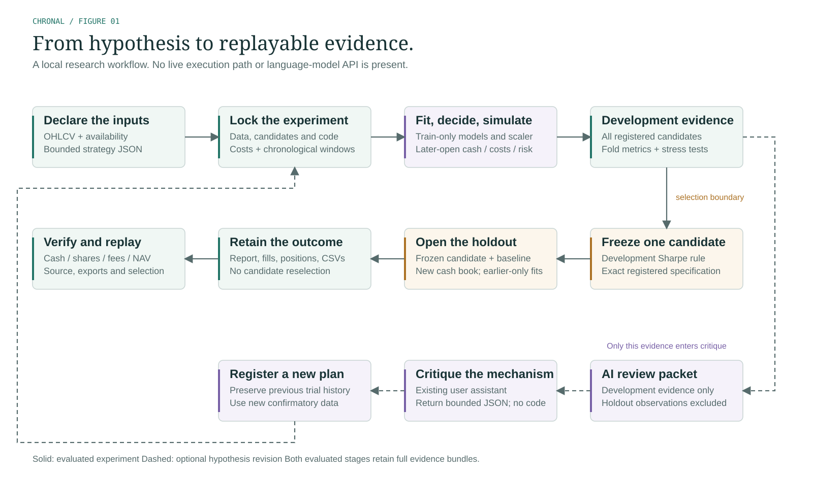

# Architecture and extension boundaries

The solid path evaluates an experiment. The dashed path uses development evidence to propose a new experiment; holdout observations are excluded. [Editable source](figures/research-lifecycle.svg) · [PNG preview](figures/research-lifecycle.png) · [Figure provenance](figures/README.md).

The implementation has ordinary modules rather than a plugin registry, service graph or agent scheduler:

| Module | Owns |
|---|---|
| `data.py` | Immutable validated market panels, strict import/export, synthetic fixtures and semantic hashes |
| `spec.py` | Bounded frozen hypotheses, numeric limits and strict JSON |
| `strategies.py` | Trailing features, train-only ridge state, capped target proposals and estimated-volatility reduction |
| `engine.py` | Later-open fill scheduling, shared cash, positions, fees, volume capacity, publication-aware risk latch and events |
| `evaluation.py` | Chronological fold composition, candidate selection, metrics, stress scenarios and conditional resampling |
| `artifacts.py` | Frozen plans, atomic result folders, CSV/JSON, content manifests, semantic selection checks and independent accounting replay |
| `report.py` | Standalone responsive HTML/CSS/SVG report with inert data and text-only insertion |
| `study.py` | Registered synthetic replication recipe and all observations |
| `cli.py` | Explicit local command workflows and concise failure messages |

`MarketData` owns immutable copies, including metadata. Feature/model state never mutates the source panel. Normal and risk decisions have separate availability rules from ex-post evaluation marks. Simulation returns a complete ledger, not only a return series. Numeric decisions remain outside the language-model interface.

The root manifest covers the four locked input/config files. Development and holdout each have their own manifest linked to the plan hash. Results are written in a fresh sibling temporary directory and renamed only after completion. A failed result build does not overwrite a valid result folder. A completed plan may remain when a later phase fails, allowing inspection and continuation. No background service or database is required.

`verify` checks source/input identity, bundle hashes, frozen-selection consistency, report chronology/provenance, regenerated CSV exports and independent fill-ledger reconciliation. It also accepts multi-seed study folders: hashes, registered seeds and observation completeness are checked, and `--replay` reruns every registered replication. `--replay` additionally refits models, reruns simulations and recomputes financial summaries, conditional uncertainty and stress scenarios. Numeric comparisons permit small floating-point tolerance. Manifests record the observed Python/NumPy environment; package source changes intentionally invalidate old plans. Replay across a different NumPy/BLAS platform is not guaranteed bitwise identical.

This separation is for traceability, not extensibility for its own sake. Add a strategy through a reviewed deterministic implementation and a bounded kind only when the new mechanism warrants it. Test available-only features, label endpoints and future-suffix invariance. Do not introduce arbitrary import paths or executable snippets into JSON.

Corporate actions, multiple currencies, shorting, leverage, derivatives and intraday orders cross the trusted accounting scope. Prefer a verified adapter to Nautilus or LEAN over growing the daily engine into a competing execution framework. A future adapter needs explicit instrument/data conversion, execution assumptions, license review and numerical conformance tests. None is claimed implemented now.

Richer optimization should use an established solver library once the workflow needs it. Large model research should use existing ecosystems such as Qlib. Learned state still needs training-only fits and preserved artifacts after integration. These are future design directions, not installed or tested capabilities.
