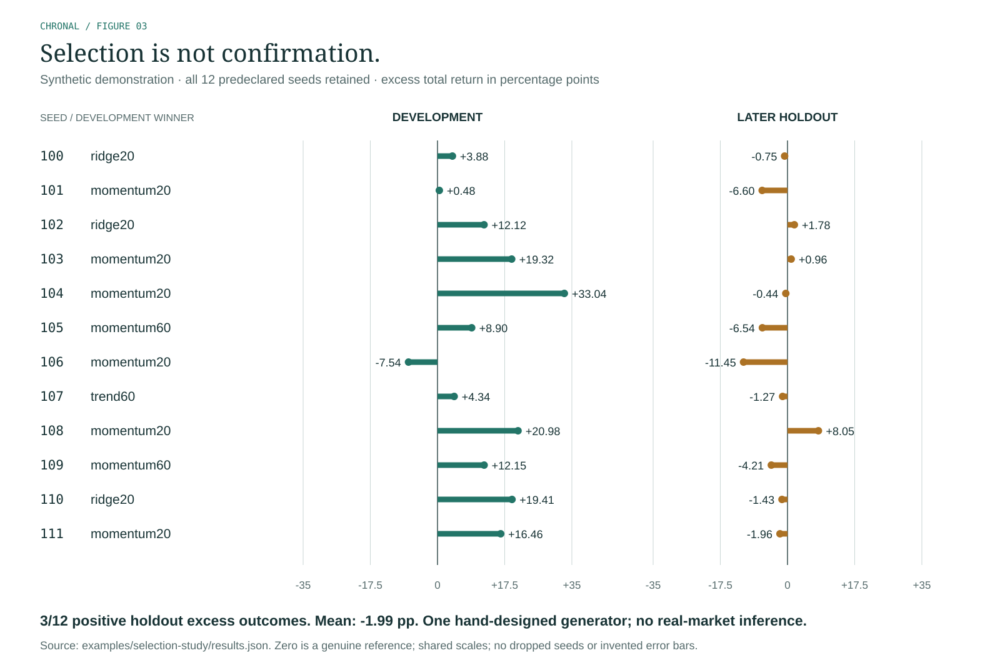

# Synthetic selection study

This is a reproducible engineering experiment, not a market-performance benchmark. The recipe was saved before the first replication in the local run. No independent timestamp, preregistration service or untouched real market was used.

## Question

When one of four candidates is selected by development Sharpe, how does its later performance compare with the fixed risk-controlled equal-weight baseline under the same execution assumptions?

## Design

- Twelve consecutive predeclared seeds, 100–111; 756 synthetic sessions and four fictional assets per seed.
- Five total specifications: one fixed baseline and four candidates, all printed in registration.json.
- Initial training 252, purge gap 2, expanding fits every 63 test sessions; 376 development sessions, then 126 separate holdout sessions.
- Full cash ledger with 5 bps commission, 4 bps full spread, 3 bps slippage, 1% daily-volume capacity and a 25% drawdown latch.
- Selection uses development evidence only. The holdout tests the selected candidate and baseline, with no candidate reselection.
- Development stresses double costs and add one session of execution delay. All replications, including unfavorable ones, are retained.



All seeds are shown on shared zero-centered scales. The figure is generated directly from the retained JSON, with no inferred intervals or dropped replications. [Editable SVG](figures/synthetic-selection.svg) · [PNG preview](figures/synthetic-selection.png).

## Observed results

The selected candidate exceeded the baseline on **3 of 12 holdouts**. Mean holdout excess total return was **-1.99 percentage points**, with a sample standard deviation of **4.91 points**. The range was -11.45 to 8.05 points.

| Seed | Selected | Development excess | Holdout excess | Holdout return | Baseline return |
|---|---|---:|---:|---:|---:|
| 100 | ridge20 | 3.88 pp | -0.75 pp | 5.54% | 6.29% |
| 101 | momentum20 | 0.48 pp | -6.60 pp | 0.27% | 6.87% |
| 102 | ridge20 | 12.12 pp | 1.78 pp | 2.71% | 0.93% |
| 103 | momentum20 | 19.32 pp | 0.96 pp | 14.54% | 13.58% |
| 104 | momentum20 | 33.04 pp | -0.44 pp | 2.68% | 3.13% |
| 105 | momentum60 | 8.90 pp | -6.54 pp | 10.57% | 17.11% |
| 106 | momentum20 | -7.54 pp | -11.45 pp | -14.34% | -2.90% |
| 107 | trend60 | 4.34 pp | -1.27 pp | 2.90% | 4.17% |
| 108 | momentum20 | 20.98 pp | 8.05 pp | 2.24% | -5.81% |
| 109 | momentum60 | 12.15 pp | -4.21 pp | 9.13% | 13.34% |
| 110 | ridge20 | 19.41 pp | -1.43 pp | 4.15% | 5.58% |
| 111 | momentum20 | 16.46 pp | -1.96 pp | -6.60% | -4.64% |

These outcomes demonstrate that the workflow preserves losing and favorable observations and separates selection from its next test. They do not prove calibrated statistical inference, superiority over another engine or any investable strategy. All replications share one manually chosen synthetic generator; its dependence and regime assumptions control the result. No p-value, power claim or confidence interval across real markets is reported.

## Reproduce

```sh
python -m chronal study --out another-study --replications 12 --first-seed 100
python -m chronal verify another-study --replay
```

Inspect [registration.json](../examples/selection-study/registration.json), [every observation](../examples/selection-study/observations.csv), and [full results](../examples/selection-study/results.json). The recipe includes data seeds, candidate specifications, source hash, execution and split configuration. Regenerate under the recorded Python/NumPy versions for the closest numeric reproduction.

The separate seed 17 demo is an interface example, not a selected winning replication. Its development winner trend60 returns 1.78% in development and −1.46% on the separate holdout. Those are fictional-market outcomes, prominently labeled throughout its report.
