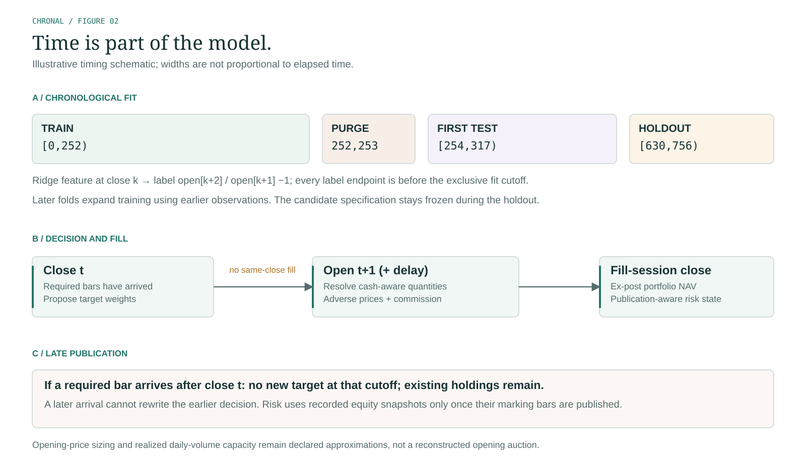

# Mathematics, clocks and execution



The default split and execution clock are schematic; widths are not elapsed-time proportions. [Editable SVG](figures/causal-timing.svg) and [PNG preview](figures/causal-timing.png).

## Chronology

For session t, complete OHLCV observations may enter a strategy only at its declared `available_at`. A normal target is decided at `close_time[t]` and is eligible at `open_time[t + 1 + delay_sessions]`. An all-NaN row means no new decision, not liquidation. A finite zero row explicitly requests cash. There is no same-close fill.

Each evaluation fold fits on `[0, train_end)` and tests `[test_start, test_end)`, with `train_end = test_start - gap`. A minimum two-session gap is enforced. Predictions for the first test opening can originate at the previous close. Target schedules are assembled across folds and passed to one continuous simulator, preserving cash, positions, pending signal timing and the risk latch across refits. Development and holdout start separate, identically funded portfolios; the holdout is not continuation performance of the development account.

## Learning and allocation

Momentum ranks assets by positive trailing close return and keeps up to top_k. Trend holds every asset with positive trailing momentum. Equal weight includes every asset. Selected assets receive `min(1 / count, max_weight)`; removed exposure remains cash. Ties use stable asset ordering. Signals rebalance when `session_index % rebalance_every == 0`, after a complete lookback.

Ridge uses one pooled regression across assets with six trailing features: one-session close return, five-session momentum, lookback momentum, sample lookback volatility, close relative to trailing mean and current overnight return. Features at close k predict `open[k+2] / open[k+1] - 1`. Training includes only examples with `k+2 < train_end`, valid contemporaneous features, and complete label bars published by the fit cutoff. Its mean, population-standard-deviation scaler, target intercept and coefficients use training examples only.

The centered ridge solve is `beta = solve(Z.T @ Z + alpha * I, Z.T @ (y - mean(y)))`. Zero-variance features receive scale 1. The intercept is unpenalized. Models are frozen within each test block; features continue updating with newly observed bars. Positive predicted scores are ranked and capped like momentum. Scores are uncalibrated research estimates, not probabilities, expected-return guarantees or investment advice. Exact feature formulas, coefficients, scaler, sample indices and label endpoints are saved for every fitted block.

For allocation risk, trailing simple close returns produce sample covariance S. The estimate is `0.8 * S + 0.2 * diag(diag(S))`. Estimated annual portfolio volatility is `sqrt(252 * w.T @ covariance @ w)`. If above target, multiply weights by target/estimate. Exposure is never increased to reach the target and never exceeds the original target caps. This is a fixed shrinkage heuristic, not an optimally estimated covariance or portfolio optimizer. Holdings may drift beyond target caps between rebalances.

The fixed baseline uses equal weight, lookback20, rebalance_every5, max_weight0.5 and target_vol0.12. It shares execution assumptions with candidates. It is risk-controlled; it is not necessarily matched to custom candidates' settings or realized risk, and it is not buy-and-hold.

## Cash, positions and fills

At each eligible open, NAV is cash plus existing quantities marked at that opening price. Desired quantities are target weights × opening NAV / opening reference price. This assumes execution-time dollar-target sizing at the recorded open, which is an idealization rather than a guaranteed executable auction order.

Sells release shared cash before buys. For signed quantity q and opening reference P:

```text
adverse_fraction = (spread_bps / 2 + slippage_bps) / 10000
fill_price       = P * (1 + sign(q) * adverse_fraction)
commission       = abs(q * fill_price) * commission_bps / 10000
cash_after       = cash_before - q * fill_price - commission
quantity_after   = quantity_before + q
close_NAV        = cash + sum(quantity * close_price)
```

Buys share available cash proportionally including commission and adverse prices. No short positions or negative-cash borrowing are allowed. Shares are fractional, with no lot rounding or minimum commission. Fees are explicit debits; spread/slippage are already embedded in price and are not debited again. Overnight gaps affect existing positions. Terminal positions remain marked, with no invented closing liquidation.

Normal fill quantity is bounded by `max_participation * min(signal_session_volume, realized_fill_session_volume)`. Signal volume must be available at its decision close. Risk liquidation uses the latest prior bar volume actually known before that opening. Zero capacity means no fill. Unfilled normal quantities expire at that opening; only another target or latched risk action retries. Realized daily volume is an ex-post capacity proxy and does not reveal opening auction depth. There is no nonlinear market impact, queue or order-book simulation.

## Drawdown circuit

The report marks every realized close. The risk process separately consumes only actual recorded account-equity snapshots whose marking bars have all been published by the current decision close. Newly published snapshots update the observed highwater; the latest observable snapshot supplies the current risk drawdown. Delayed peaks use their original account snapshots, not current positions valued at old prices. Unavailable current marks produce a logged event.

When observed drawdown reaches the configured threshold, the circuit latches. Every later open attempts to flatten, subject to capacity and costs. New risk positions remain disabled for that entire simulation. There is no automatic re-entry. A close stop cannot prevent overnight gaps or guarantee liquidation; publication delays and insufficient volume can postpone action. The risk highwater includes initial capital.

## Metrics and uncertainty

Daily simple return is `NAV[t] / NAV[t-1] - 1`, including initial capital before the first evaluated mark. Total return is terminal/initial minus one; CAGR is `(terminal/initial) ** (252 / session_count) - 1`. Volatility uses sample standard deviation ×√252. Sharpe is mean simple daily return / sample standard deviation ×√252, at zero risk-free rate. Zero or unavailable dispersion produces null, never fabricated infinity. Selection ranks undefined Sharpe last and uses a lexical tie break; a degenerate all-undefined comparison provides no useful skill evidence.

Drawdown is `NAV / cumulative_max(NAV including initial) - 1`. Historical CVaR95 is the average of the worst `ceil(0.05 * count)` daily returns. It is signed, so negative values denote losses. Turnover is traded absolute notional / initial regional capital / sessions. Fold turnover uses the capital at that fold's start; fold fees/notional come from actual fills within its session bounds. Dollar totals reconcile across folds. Cash yield is zero; no inflation adjustment or taxes apply.

A stress that would violate ExecutionConfig bounds is reported as unavailable with its reason; the valid base experiment remains complete. No invalid cost is clipped or replaced with a fabricated performance number.

Development selects the nonbaseline candidate with highest aggregate zero-risk-free Sharpe. The holdout evaluates only that frozen candidate and the fixed baseline. Training expands prospectively within the holdout using only labels before each later fit cutoff; the strategy specification and selection remain frozen. There is no claim that the development score is an unbiased estimate of the chosen candidate's performance.

The paired circular moving-block bootstrap samples aligned daily excess returns in blocks of ten sessions, with 500 local seeded resamples, and reports the 2.5th/97.5th percentiles of their mean. This holds fitted paths fixed. It is a descriptive conditional range, not a forecast interval, multiple-testing correction, independence proof or calibrated test of alpha. Candidate count is disclosed; discarded trials outside the plan remain unobserved by the software.

## Descriptive report diagnostics

The report derives monthly returns from the evaluated net NAV path, including initial cash to first session. Each UTC month compounds its sessions; boundary months may be partial. Ulcer index is RMS running-peak drawdown across marked sessions, with initial capital included in peak formation. Underwater duration counts consecutive sessions strictly below the previous peak, excluding recovery and retaining unrecovered endpoints. Historical tail mean is the signed mean of the worst ceil(0.05 × session count) daily returns, with the count shown. Different upstream libraries use different tail conventions; these figures are descriptive, not forecast loss bounds. `portfolio_diagnostics` also returns episode peak/trough/recovery indices and terminal baseline excess for programmatic inspection. Selection, simulation and candidate search are unchanged.
