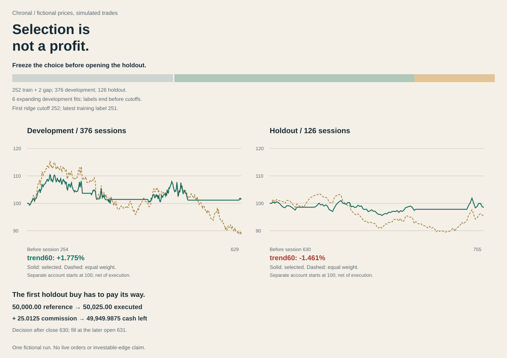

# Selection is not a profit

This worked case runs current-main Chronal on its existing **fictional seed 17 prices**, original four registered candidates, equal-weight baseline, windows and execution assumptions. It is an implemented product workflow, not a new study, live trading result or search for a better strategy.

## Freeze information, then open the holdout

The first fit uses sessions `[0,252)`, followed by a two-session purge gap. Development evaluates376 sessions `[254,630)` with six expanding fits. Every ridge training-label endpoint stays strictly before that fit's exclusive cutoff:251<252,314<315,377<378,440<441,503<504 and566<567. Features use available bars; the ridge model and scaler are fitted using training data, not the final holdout. Development numerical input is truncated before session 630.

Chronal selects `trend60` by development-only zero-risk-free Sharpe, with the documented lexical tie break. The final126-session holdout `[630,756)` evaluates only that frozen candidate and equal weight, with two ordinary expanding fits. Holdout prices or results do not enter the development-only assistant packet. This is an explicit software boundary, not a secret vault: the operator can read the input CSV and perform other trials.

<picture><source media="(max-width: 600px)" srcset="chronology-mobile.svg"></picture>

Each region starts a **separate 100,000-unit simulated account**, normalized to 100 in its plot. The figure does not join development wealth to holdout wealth. Cash continues across model refits within each region. Both charts share the same 85–120 vertical scale and retain every marked equity value plus initial capital; no path is smoothed or shortened. Session indices are zero-based and described by the native records.

## Report the losing outcome

The selected development path returns **+1.7750157688%** net. The frozen candidate then returns **−1.4609501614%** on holdout, ending at **98,539.0498386246** account units. Equal weight also loses, at **−4.5282002428%**. Losing less than this baseline does not make the selected strategy profitable or establish an investable edge.

The held selected path incurs **233.4856705413** commission units; spread/slippage are already embedded in execution prices and net equity, rather than counted again as commissions. Development double-cost stress reduces the selected return to **+0.4340757003%**. The one-session delay stress happens to improve it to **+2.9542390097%** in this fictional path; it is not evidence that execution delay helps generally. The original separate 12-replication study and its 3/12 baseline wins remain unchanged in the [research record](../EXPERIMENT.md).

## Reconcile one fill and one constraint

At close session 630, the selected strategy requests a buy of fractional `SYN_C` shares. It fills at the later open631:

```text
412.8366488298134 shares × 121.1132784400928 reference = 50,000.0000
Adverse execution price: 121.17383507931284             = 50,025.0000
Commission: 5 bps of executed notional                 =     25.0125
100,000.0000 − 50,025.0000 − 25.0125                    = 49,949.9875 cash
```

These are arbitrary simulated account/price units, not real dollars or broker fills. Four-basis-point spread contributes its half-spread plus three-basis-point slippage, for five basis points of adverse execution in this buy. Commission is separate. Later marked equity includes current inventory valued at the recorded close.

At development session 476, the `SYN_A` request is constrained by shared cash: 277.1302207263 requested shares become 276.7565753925 filled, with 0.3736453338 expiring and reason `cash_limit`. The interface shows request, capacity, cash scale, fill and expiry together. These are recorded daily-simulation approximations, not opening-auction liquidity.

[Model inspector](model-terminal.png) · [cash-aware execution inspector](constrained-terminal.png) · [selected-session account](account-terminal.png) · [losing holdout](holdout-terminal.png) · [phone account](phone-terminal.png).

## Use the current report and take the evidence

[Open the current-source development report](worked-run/development/report.html) · [holdout report](worked-run/holdout/report.html) · [download complete portable example](worked-example.zip).

Download/extract the repository or ZIP; GitHub displays HTML source. Both reports are offline files with inline scripts/styles/data and no external requests. Press `/` for the command bar, then use:

```text
strategy ridge20
fit #1
```

in development to inspect the actual training-only model. To inspect the cash-constrained request, use `strategy trend60`, `session #223`, `asset #1`, `goto execution`. In holdout use `session #2`, `goto account`, `view drawdown`. These are inspection commands, not orders. The slider supports arrows, help supports Escape, and an unknown strategy is refused without changing selection. CSV export downloads the exact native file bytes. Freshly reopening the HTML restores its saved experiment, not an unsaved command-history session.

The native plan/data/candidates, complete development/holdout results, manifests, reports and CSVs are in [worked-run](worked-run). The ZIP includes those exact bytes, the matching complete Chronal Python source, license, dependency snapshot, its own local README and a verifier. A fresh extraction verifies and numerically replays both regions under NumPy 2.5.4; no model is downloaded or external service called. Existing result destinations are refused while original artifacts are retained.

## Why this new packet exists

The historical `examples/demo` files retain code fingerprint `9723bcd2…`; current main's package fingerprint differs. The strict verifier correctly refuses that record under current source. No old manifest, source hash or numerical record was rewritten to hide it. This current-source run uses the same supplied input/candidates/settings through **plan → research → holdout → verify --replay**. Its numerical paths reproduce the historical outcome; its new source/environment identity is recorded honestly. The historical plan says Python 3.14.7; this verified run uses existing CPython 3.14.10 and NumPy 2.5.4.

## Keep the boundary and credits

Read the full [method](../METHOD.md), [architecture](../ARCHITECTURE.md), [data/provenance contract](../DATA.md), [terminal guide](../TERMINAL.md), [AI workflow](../AI_WORKFLOW.md), [verification](../VALIDATION.md) and [original license](../../LICENSE). Long-only, one-currency, fixed-universe, daily OHLCV assumptions, declared publication times, fractional shares, daily capacity and descriptive bootstrap limitations remain authoritative. No corporate actions, FX, taxes, margin, order book or live brokerage route is introduced. Original generated data and code retain MIT authorship/terms; separately installed NumPy retains its BSD/dependency notices.
